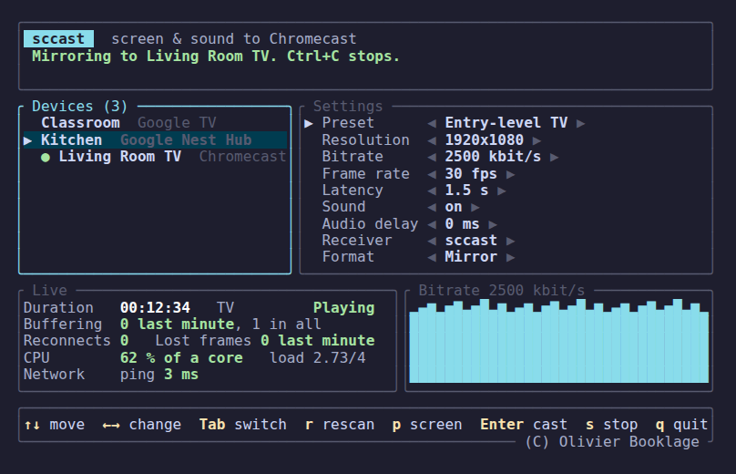

# sccast

`sccast` casts a Linux desktop's screen and sound to a Chromecast or any
device with Chromecast built-in, as HLS served over HTTP on your local
network and played by sccast's own receiver page.

It does not use Google's screen mirroring, the one Chrome and Brave use.
Expect 2 to 3 seconds of delay on the TV, about 5 if sccast falls back to
Google's receiver.

## Requirements

- A Wayland session with `xdg-desktop-portal` (tested on KDE Plasma).
- PipeWire, with `pipewire-pulse` for sound.
- GStreamer (tested with 1.24).
- A Rust toolchain (`cargo`) 1.92 or newer, only to build from source.
- Linux PC and TV with Chromecast built-in or Google Chromecast device on the same local network, mDNS (UDP 5353) allowed between
  them.

## Install

KDE neon and Ubuntu 26.04: download the `.deb` for your system from the
[latest release](https://github.com/obook/sccast/releases/latest), then:

```sh
sudo apt install ./sccast_*_amd64.deb
```

`apt` installs the GStreamer plugins it needs.

### Build from source

Debian, Ubuntu and derivatives (tested on KDE neon 24.04):

```sh
sudo apt install pkg-config libgstreamer1.0-dev gstreamer1.0-tools \
  gstreamer1.0-plugins-{base,good,bad,ugly} gstreamer1.0-libav \
  gstreamer1.0-pipewire
```

Fedora (not tested; `x264enc` comes from RPM Fusion):

```sh
sudo dnf install pkgconf gstreamer1-devel gstreamer1-plugins-{base,good,bad-free} \
  gstreamer1-plugins-ugly gstreamer1-plugin-libav pipewire-gstreamer
```

Arch Linux (not tested):

```sh
sudo pacman -S pkgconf gstreamer gst-plugins-{base,good,bad,ugly} gst-libav \
  gst-plugin-pipewire
```

Check the GStreamer elements, then build:

```sh
gst-inspect-1.0 pipewiresrc pulsesrc x264enc hlssink2 avenc_aac > /dev/null
cargo build --release
```

The binary is `target/release/sccast`.

## Firewall

Open TCP port 8090 to your local network:

```sh
sudo ufw allow from 192.168.1.0/24 to any port 8090 proto tcp   # ufw
sudo firewall-cmd --add-port=8090/tcp --permanent && sudo firewall-cmd --reload   # firewalld
```

Replace `192.168.1.0/24` with your network.

## Usage

```sh
sccast                                       # menu: device, presets and settings
sccast list                                  # devices on the network
sccast cast                                  # pick a device, then a screen
sccast cast --device "Living Room TV"        # name or id from `sccast list`
sccast cast --device "Kitchen" --resolution 1280x720
sccast cast --device "Kitchen" --file movie.mp4
sccast stop --device "Kitchen"               # close a cast left running
sccast serve                                 # local stream, no TV
```



In a terminal, `sccast` and `cast` without `--device` ask for the screen,
then open a menu: the devices appear as they answer, and the command line
options prefill the settings. Arrows move and change, Tab switches columns,
Enter casts, or casts again with the new settings. The menu stays during the
cast with its state, duration, buffering, CPU and bitrate. `s` stops, `p`
chooses another screen, `q` or Ctrl+C quits and frees the TV. Between two
casts to the same TV, the receiver stays open on it.

`cast` opens the screen picker, waits about 6 seconds for the stream to
fill, then starts the TV. Ctrl+C stops the TV at once.

`serve` prints a URL for `ffplay`, to tell a capture problem from a TV
problem. VLC stutters on this live stream and is not a reliable check.
`serve --test-pattern` streams a test image and ticks instead.

| Option | Default | Effect |
|---|---|---|
| `--resolution WxH` | `1920x1080` | Output size, letterboxed to keep the screen shape |
| `--fps N` | `30` | Frame rate |
| `--bitrate KBPS` | `2500` | Video bitrate in kbit/s |
| `--port N` | `8090` | HTTP port the TV fetches the stream from |
| `--no-audio` | | Video only |
| `--format mkv` | `hls` | One continuous Matroska stream instead of HLS segments (experimental, about 5 to 6 s of delay) |
| `--audio-delay MS` | `0` | Delays the sound on the TV (`cast` only) |
| `--url URL` | | Plays a media URL instead of the screen (`cast` only) |
| `--file PATH` | | Plays a local MP4 file instead of the screen (`cast` only) |

## Receiver

The TV runs sccast's receiver, the page in `docs/receiver/` served at
<https://obook.github.io/sccast/receiver/> and published in the Google Cast
console as application `8FE12008`. It plays 1 second behind the newest
segment, against 3 for Google's Default Media Receiver.

If it does not start, `sccast` falls back to the Default Media Receiver
(about 5 seconds of delay) and says so. A device may not know the
application until it has been restarted once.

| Option | Effect |
|---|---|
| `--latency SECONDS` | Delay behind the newest segment for sccast's receiver |
| `--receiver CC1AD845` | Always use the Default Media Receiver |
| `--receiver ID` | Use your own receiver, registered in the [Cast console](https://cast.google.com/publish) |

A debug build (`cargo build`) shows the delay in a corner of the TV.

## Troubleshooting

No device found: the PC may block mDNS (UDP 5353).

Stuck on the Cast logo: the firewall most likely blocks port 8090.
`RUST_LOG=sccast=info,tower_http=debug` shows whether the TV requests the
stream.

"refused the stream": the device cannot decode the format. A Google Nest
Hub plays `--resolution 1280x720` but refuses 1080p.

Sound before image: the PC speakers play live, a few seconds ahead of the TV.
Mute the PC in the desktop: on PipeWire, the stream keeps its sound (checked
on KDE neon). If the TV sound leads its image, add `--audio-delay 200` and
adjust.

Image but no sound, with a Chromecast on HDMI: set the TV audio output to
PCM (needed on a Sharp TV, with every app).

Stutter, or sound ahead of a frozen image, on moving content: the TV may not
decode 1080p in real time. Try `--resolution 1280x720 --bitrate 2500`.

The TV drops back to its home screen: `sccast` launches the receiver again,
up to 3 times in 5 minutes, without limit in the menu. If the device no
longer shows in `sccast list`, unplug it and plug it back in.

The first launch on a Chromecast can fail after about a minute: the menu
tries again by itself, the next launch takes a few seconds.

Logs: `RUST_LOG=sccast=debug sccast cast`. The menu always writes its log to
`$XDG_RUNTIME_DIR/sccast.log`, emptied at each start.

## Limitations

- 2 to 3 seconds of latency: the stream is cut into 1-second segments, and
  the receiver plays 1 second behind the newest one.
- The TV loads sccast's receiver from GitHub Pages, so it needs internet
  access.

## Roadmap

See [ROADMAP.md](ROADMAP.md).

## Author

Olivier Booklage <olivier.booklage@ac-bordeaux.fr>

## License

MIT, see [LICENSE](LICENSE).

The Rust dependencies use MIT, Apache-2.0, ISC or BSD licenses. At run
time, `sccast` loads GStreamer (LGPL-2.1 or later) and its `x264enc`
plugin, which wraps x264 (GPL-2.0 or later).
